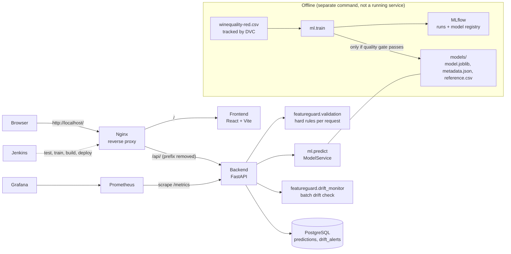

# Architecture

## Request-to-prediction workflow (everyone must be able to explain this)

1. Browser sends `POST /api/predict` to Nginx. Nginx strips `/api/` and forwards to FastAPI.
2. FastAPI runs `validate_features` (required fields, types, ranges, schema consistency).
   - Invalid: HTTP 422 with a list of reasons; the rejected request is stored with status `rejected`; the rejection counter increases.
3. Valid: `ModelService.predict` runs the saved sklearn Pipeline (scaler + Random Forest). No training happens here.
4. The prediction is saved in PostgreSQL (`validation_status = accepted`) and returned.
5. Every `DRIFT_BATCH_SIZE` accepted requests (default 30) form a batch; it is compared with the training data (`reference.csv`). The result is stored in `drift_alerts`; if enough features drifted, `drift_detected = true` and the dashboard and Grafana show an alert. Requests are never blocked by drift.
6. Prometheus scrapes `/metrics` every 10 s; Grafana plots it.

## Validation vs drift (do not mix these up)

| | Feature validation | Drift monitoring |
|---|---|---|
| Question | Is THIS input physically sensible? | Has the DISTRIBUTION of inputs changed vs training? |
| Unit | one request | a batch (30+ rows) |
| Action | reject with HTTP 422 | record an alert, show it, keep serving |
| Code | `featureguard/validation.py` | `featureguard/drift_monitor.py` (Evidently or KS test) |

## Application metrics vs model-quality metrics

* Application metrics (Prometheus/Grafana): traffic, latency, errors, rejections, drift alerts. Real, scraped live.
* Model quality (MAE, RMSE, R2): computed once at training time on the held-out test split, stored in MLflow and `models/metadata.json`, shown in the **Model** tab. They describe the model, not live traffic.

## Where each component runs

| Component | Docker Compose | Kubernetes |
|---|---|---|
| Frontend, Backend, PostgreSQL, Nginx | yes | yes |
| Prometheus, Grafana | yes | yes |
| MLflow server | yes | no (stays in Compose / local) |
| Jenkins | local install (port 8080) | no (stays outside the cluster) |
| ML training | host command | host command |
